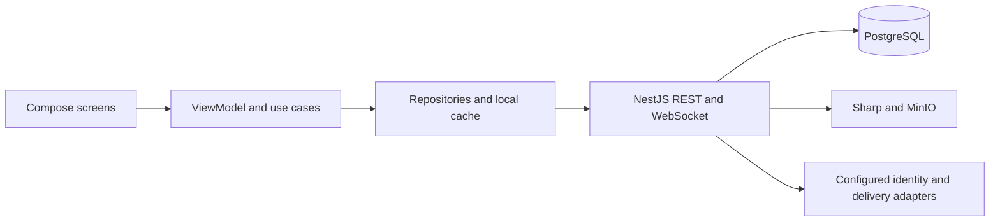

# Velora

Native Android dating application with a Kotlin/Compose client and a NestJS backend. **Active development:** substantial product flows exist in code, but the application is not a beta release or a production-ready service.

## About

A mobile product for profile discovery, mutual matches and conversations, with privacy and safety controls built into the client/API design.

## Problem

A dating experience needs more than a swipe screen: authentication, profile media, relationship state, chat reliability, privacy and abuse controls must work together.

## Why I Built It

The product rationale is to explore that complete mobile-to-backend journey in one independently developed project, including the less visible state and failure-handling work. Adoption and commercial validation have not been measured.

## What I Built

The project includes the Android application, API, SQL migrations, media-processing boundary, local development setup and automated tests. The scope spans product flows and integration rather than a collection of isolated UI mockups. See the status matrix for verification limits.

## Key Features

Implemented code paths include:

- Email authentication, token refresh, onboarding and profile editing.
- Discovery, likes, reciprocal matches and public profile navigation.
- Persisted chat with reconnect logic, message delivery/read state and media paths.
- Photo processing into bounded JPEG variants with EXIF removal.
- Blocking, reporting, unmatching, account visibility and deletion paths.
- Russian/English resources, approximate location and account-scoped response caching.

These are implementation facts, not a claim that every flow has passed a current device/backend test.

## Tech Stack

Kotlin, Jetpack Compose, Hilt, Coroutines/Flow, Retrofit/OkHttp, DataStore; TypeScript, NestJS, PostgreSQL, WebSocket, MinIO/S3, Sharp; Gradle, Docker Compose, Vitest and Android/JVM tests.

## AI-Assisted Development

Developed with **ChatGPT / Codex**, as confirmed by the project author. AI served as an engineering copilot during iterative development; this is an independent product-building project involving scope decisions, integration, debugging and review. No per-file human/AI authorship percentages, user metrics or production outcomes are claimed.

## Current Status

🟡 **Active development** — audited 2026-09-19.

| Classification | Evidence and limits |
|---|---|
| WORKING — verified locally | Backend compilation and 18 unit tests; Android debug build; 11 freshly rerun JVM tests pass; lint completes with 28 warnings and no errors. |
| PARTIAL | Integrated authentication, discovery, media, safety and chat flows are implemented. This audit did not run the API/database/storage integration suite or device UI tests. |
| EXPERIMENTAL | Development Premium activation, development push registration and provider development assertions. These are not real payments or production notification delivery. |
| NOT IMPLEMENTED / not connected | Production SMS sender explicitly returns 503. Production billing, Android FCM registration, production recovery email delivery, moderation console and deployed operations are not established. OAuth needs external configuration and live verification. |

Working: the local compilation/unit-test scope above. In progress: reliable end-to-end integration and real provider delivery. Planned: billing, production delivery adapters, moderation and operational deployment. Historical stage reports use older readiness language; they do not change this status.

## Architecture



Entrypoints: `app/src/main/java/app/velora/MainActivity.kt`, `VeloraApplication.kt`, and `backend/src/main.ts`. Data/domain/presentation boundaries live under `app/src/main/java/app/velora/`.

## Screenshots / Demo

Demo: **Coming soon**. Reviewed public captures belong in [docs/screenshots](docs/screenshots/) and [docs/demo](docs/demo/). Existing local `captures/` files are excluded because they can contain account and session information.

## Running / Building

Prerequisites: JDK 17+ compatible with the included Gradle wrapper (this audit used JDK 21), Android SDK 35, Node.js (the container uses Node 24), Docker Engine with Compose for PostgreSQL/MinIO/backend.

```powershell
# From the repository root; generates ignored local secrets.
.\scripts\setup-dev.ps1 -StartServices
cd backend
npm ci
npm run build
npm test
cd ..
.\gradlew.bat :app:assembleDebug :app:testDebugUnitTest :app:lintDebug
```

Inspect the setup script before running it. Alternatively copy `.env.example` to `.env`, replace placeholder secrets, and run `docker compose --env-file .env up -d --build`.

For backend development use `npm run start:dev` in `backend/` (loads the root `.env`). `npm start` uses `dist/src/main.js` after a local build and expects environment variables to be supplied by the caller. The Dockerfile compiles only `src/` and uses its separate `dist/main.js` entrypoint.

The debug API default `http://10.0.2.2:8080/` is the Android emulator host alias. Override `VELORA_API_BASE_URL` for another environment. Never embed backend provider secrets in the APK.

Build: **PASS** (backend and Android debug). Unit tests: **PASS** (18 backend and 11 freshly rerun Android/JVM tests). Integration/device tests: **NOT AVAILABLE** in this audit; Docker Engine was stopped and no adb device was attached. See [verification details](docs/PORTFOLIO_AUDIT.md).

## Development Notes

- Privacy, media handling and reconnect behavior are meaningful engineering areas, but unit tests cannot establish deployed reliability.
- Realtime fan-out and presence need additional work before horizontal scaling; production purge scheduling is not established.
- No license has been added because ownership and reuse rights for every asset/dependency were not established.
- Backend dependency audit: **12 vulnerable package entries (5 high, 7 moderate)** remain open; see [details](docs/DEPENDENCY_AUDIT.md).
- **Publication secret scan: PASS (2026-09-20).** The author confirmed the historical login defaults were fictional; both values were removed from the publication history. Current source is unchanged, and local `.env` remains ignored. This does not resolve the dependency findings above. See [security review](docs/SECURITY_AUDIT.md).
