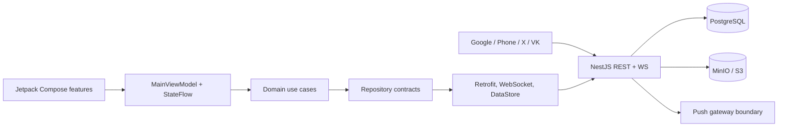

# Architecture

## System view

The client follows pragmatic Clean Architecture and MVVM. One Android application module keeps MVP build time and dependency management simple; package boundaries already separate `domain`, `data`, `presentation`, dependency injection, design system, and feature UI. These boundaries can become Gradle feature modules without changing repository interfaces.

## Android layers

- UI: Compose screens for localized auth, onboarding, discover, the ID-addressed `UserProfileScreen`, fullscreen zoomable photo pager, match, matches, chats, own profile, settings, recovery, and Premium. Navigation Compose owns the back stack and bottom-navigation state; public-profile routes carry only `userId`.
- Presentation: `MainViewModel` exposes one immutable `AppUiState` over `StateFlow`. It coordinates feature workflows and never calls Retrofit directly.
- Domain: models, repository interfaces, and focused use cases for credentials, onboarding, likes, and messages.
- Data: Retrofit DTOs and repositories, OkHttp authentication/refresh, provider adapters, foreground location, resilient WebSocket reconnect with exponential backoff, an authenticated Coil image loader, encrypted session storage, connectivity observation, and a bounded DataStore response cache.
- DI: Hilt binds repository and notification implementations and owns networking singletons.

All visible copy lives in Android resources. `values/` is English and `values-ru/` is Russian; adding another locale requires a resource directory, not application-code branches. AppCompat per-app locales persist System/Russian/English selection across restarts, while the optional account preference is synchronized to the backend.

Google authentication is isolated behind Credential Manager, VK behind the official VK ID adapter, and X behind the browser/custom-tab deep-link adapter. External credentials only prove identity; repositories exchange the verified provider result for the same encrypted Velora access/refresh session used by email login.

Access and refresh tokens are encrypted with AES-GCM using a non-exportable Android Keystore key before being written to DataStore. Discover, matches, conversations, messages, and public profiles have a small account-scoped local cache for offline read states. Authoritative 404 responses purge cached profiles, and logout/account changes clear the cache so blocked, deleted, or cross-account data cannot be resurrected.

## Backend boundaries

- Controllers expose auth, user/profile/media, dating/chat/safety, subscription, notification, and health endpoints.
- Services own JWT issuance and rotation, notifications, migrations, PostgreSQL access, and S3-compatible object storage.
- `auth_identities` maps email, Google, phone, X, and VK subjects onto one user. Provider email metadata never causes automatic account merging, and transactional unlinking preserves at least one login method.
- Phone challenges are HMAC-protected, expiring, one-time records with cooldown, attempt lockout and phone/IP/device request limits. `SmsSender` separates development delivery from an unconfigured production adapter.
- Profile coordinates live in the private `profile_locations` model. Discovery performs server-side radius filtering and returns only city, country and integer approximate distance.
- `GET /users/:userId/profile` builds one privacy-filtered public DTO with aggregate relationship state. It rejects blocks, hidden/non-discoverable strangers, deleted or suspended accounts and never serializes credentials, provider subjects, private coordinates, moderation data, tokens, IPs, or devices.
- Profile upload validates the decoded image with Sharp, bounds bytes/dimensions/pixels, discards EXIF/IPTC/XMP (including GPS), and stores thumbnail/medium/full derivatives in MinIO. PostgreSQL stores only ownership and object metadata.
- Every migration runs once under a PostgreSQL advisory lock and is recorded in `schema_migrations`.
- Likes and daily quotas use transactions and advisory locks. A reciprocal like atomically restores or creates the match and conversation.
- Chat REST writes are persisted before a WebSocket event is broadcast. A per-sender `clientMessageId` unique constraint makes retries idempotent. WebSocket membership is checked against an active match for every event; heartbeat, foreground/network triggers and client exponential reconnect handle transient disconnects. Delivered/read events update the same persisted message rows.
- Presence is server authoritative: active sockets set `presence_active`, heartbeat updates `online_at`, the final close clears active state, and a startup reset prevents stale-online rows. Privacy changes are pushed to live sockets immediately. The in-memory hub is intentionally single-instance for beta; horizontal deployment must move fan-out/presence coordination to Redis or an equivalent broker.
- Scoped rate limits are persisted by hashed subject for login, registration, OTP, profile views, likes, passes, messages, reports and uploads. Structured request logs contain request ID, method, path, status and duration but not bodies, credentials, authorization headers or private coordinates.

## State and failure handling

1. Splash observes encrypted session presence.
2. A valid session loads `/users/me`; incomplete profiles enter onboarding.
3. Ready state loads discover, matches, conversations, preferences, blocks, subscription, received likes, and photos concurrently.
4. OkHttp retries one unauthorized request after serialized refresh-token rotation.
5. Network failures surface bounded loading/retry/offline states; cached core lists remain readable and reconnect is triggered by connectivity plus foreground transitions.
6. Logout revokes the refresh token where possible, unregisters the device, clears tokens, and clears response cache.

## Privacy choices

Coordinates exist only server-side and are quantized to three decimal places before storage. Android requests foreground location only and accepts approximate permission; users can instead save a city with no coordinates. Discovery returns an integer approximate distance and never returns latitude, longitude, accuracy or source for another user. City, distance, online state, read receipts and discovery visibility are independently enforced by backend preferences. Chat photos require an active conversation; profile media has authenticated opaque UUID/variant URLs. Blocking immediately ends the match, closes its sockets, removes likes, hides both profiles from one another and prevents new messages.
