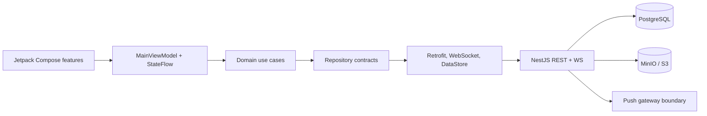

# Architecture

## System view

The client follows pragmatic Clean Architecture and MVVM. One Android application module keeps MVP build time and dependency management simple; package boundaries already separate `domain`, `data`, `presentation`, dependency injection, design system, and feature UI. These boundaries can become Gradle feature modules without changing repository interfaces.

## Android layers

- UI: Compose screens for auth, onboarding, discover, profile detail, match, matches, chats, own profile, settings, recovery, and Premium. Navigation Compose owns the back stack and bottom-navigation state.
- Presentation: `MainViewModel` exposes one immutable `AppUiState` over `StateFlow`. It coordinates feature workflows and never calls Retrofit directly.
- Domain: models, repository interfaces, and focused use cases for credentials, onboarding, likes, and messages.
- Data: Retrofit DTOs and repositories, OkHttp authentication/refresh, resilient WebSocket reconnect, Coil image loading, encrypted session storage, and response cache.
- DI: Hilt binds repository and notification implementations and owns networking singletons.

Access and refresh tokens are encrypted with AES-GCM using a non-exportable Android Keystore key before being written to DataStore. Discover, conversation, and message responses have a small local cache for offline read states. Mutable server data remains authoritative.

## Backend boundaries

- Controllers expose auth, user/profile/media, dating/chat/safety, subscription, notification, and health endpoints.
- Services own JWT issuance and rotation, notifications, migrations, PostgreSQL access, and S3-compatible object storage.
- Every migration runs once under a PostgreSQL advisory lock and is recorded in `schema_migrations`.
- Likes and daily quotas use transactions and advisory locks. A reciprocal like atomically restores or creates the match and conversation.
- Chat REST writes are persisted before a WebSocket event is broadcast. WebSocket membership is checked against an active match; heartbeat and client exponential reconnect handle transient disconnects.

## State and failure handling

1. Splash observes encrypted session presence.
2. A valid session loads `/users/me`; incomplete profiles enter onboarding.
3. Ready state loads discover, matches, conversations, preferences, blocks, subscription, received likes, and photos concurrently.
4. OkHttp retries one unauthorized request after serialized refresh-token rotation.
5. Network failures surface a recoverable error and cached core lists remain readable.
6. Logout revokes the refresh token where possible, unregisters the device, clears tokens, and clears response cache.

## Privacy choices

Coordinates exist only server-side. Discovery returns a rounded approximate distance in 5 km bands and never returns latitude or longitude. Chat photos require conversation membership; profile media has opaque UUID URLs. Blocking immediately ends an active match and removes both users from one another's discovery results.
