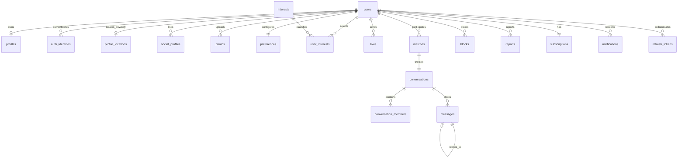

# Database

PostgreSQL 17 is the source of truth. SQL migrations live in `backend/migrations` and are applied alphabetically inside transactions. `schema_migrations` records successful files; an advisory lock prevents multiple backend replicas from racing.

## Core relationships



## Tables

- `users`: stable Velora account ID, optional normalized email/password compatibility fields, verification and active state.
- `auth_identities`: provider-neutral email/Google/phone/X/VK identities, verified metadata and last-use time. `(provider, provider_subject)` and `(user_id, provider)` are unique.
- `profiles`: 18+ birth date constraint, public identity, city, bio, goal, optional `preferred_locale`, online time, visibility, boost and onboarding state.
- `profile_locations`: private country/region/city, three-decimal approximate coordinates, GPS/manual source, accuracy and update timestamp. Manual locations can omit coordinates.
- `social_profiles`: normalized Instagram/X/VK public profile links. Instagram is not an authentication identity.
- `photos`: opaque UUID, owner, MinIO object key, unique ordered position 0-8.
- `interests`, `user_interests`: normalized many-to-many interest catalog.
- `preferences`: validated age, approximate distance, gender array, notification switch.
- `likes`: unique directed like or Super Like.
- `discover_actions`: auditable passes/likes and daily quota accounting.
- `matches`: canonical sorted user pair with reversible `unmatched_at` history.
- `conversations`, `conversation_members`: one conversation per match and membership/read cursor.
- `messages`: text/image, optional reply, persisted read and creation timestamps; media is referenced by object key.
- `blocks`, `reports`: safety records with cascading account cleanup.
- `subscriptions`: FREE/PREMIUM entitlement, expiry, provider, external billing reference.
- `notifications`, `notification_devices`: in-app events and provider-neutral device registration.
- `refresh_tokens`, `password_reset_tokens`: SHA-256 token digests, expiry, revocation/use timestamps. Raw tokens are never stored.
- `phone_otp_challenges`: HMAC code digest, E.164 phone, expiry, one-time consumption, failures/lockout and rate-limit metadata.
- `oauth_authorization_states`: single-use X/VK PKCE state with an encrypted verifier, mode, owner and expiry.

## Important indexes

- Partial discovery index on visible/onboarded profiles.
- Target/time index for received likes.
- Active-match indexes for each participant.
- Conversation/time index for message pagination.
- Partial unread-notification index.
- Partial active refresh/reset-token indexes.
- Provider-subject and per-user/provider unique indexes for identity lookup/link safety.
- Coordinate index for internal discovery distance filtering plus OTP phone/IP/device time indexes.
- Daily/pass indexes for discovery quotas and seven-day pass suppression.
- Partial boost index for promoted discovery ordering.

## Privacy and retention

Another user's latitude, longitude, accuracy and location source are deliberately absent from public API responses. Distance is calculated and filtered server-side, then returned as an approximate integer kilometre value. The authenticated owner can read their private location endpoint. Account deletion cascades identities, location, social links and relational data and explicitly removes profile/chat objects from storage. Reports are currently removed with the reporting or reported account; production moderation retention policy can move them into a separately governed audit store.

## Backup

For a development backup:

```powershell
docker compose exec -T postgres pg_dump -U velora -d velora -Fc > velora.dump
```

Production must use encrypted, access-controlled backups plus tested point-in-time recovery. MinIO/S3 versioning and lifecycle rules are separate from PostgreSQL backups.
