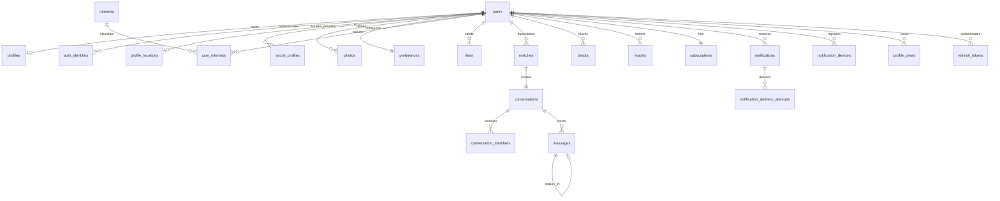

# Database

PostgreSQL 17 is the source of truth. SQL migrations live in `backend/migrations` and are applied alphabetically inside transactions. `schema_migrations` records successful files; an advisory lock prevents multiple backend replicas from racing.

## Core relationships



## Tables

- `users`: stable Velora account ID, optional normalized email/password compatibility fields, verification, active/suspended state, `deleted_at`, and scheduled `purge_after`.
- `auth_identities`: provider-neutral email/Google/phone/X/VK identities, verified metadata and last-use time. `(provider, provider_subject)` and `(user_id, provider)` are unique.
- `profiles`: 18+ birth date constraint, public identity, city, bio, goal, optional `preferred_locale`, verified flag, authoritative `presence_active`, last-online time, visibility, boost and onboarding state.
- `profile_locations`: private country/region/city, three-decimal approximate coordinates, GPS/manual source, accuracy and update timestamp. Manual locations can omit coordinates.
- `social_profiles`: normalized Instagram/X/VK public profile links. Instagram is not an authentication identity.
- `photos`: opaque UUID, owner, source and thumbnail/medium/full MinIO keys, MIME, source bytes, decoded width/height, processing/moderation status, timestamps, and a deferred unique ordered position. The configured application limit is 1-9; binary data and EXIF are absent from PostgreSQL.
- `interests`, `user_interests`: normalized many-to-many interest catalog.
- `preferences`: validated age, approximate distance, gender array, notification switch.
- `likes`: unique directed like or Super Like.
- `discover_actions`: auditable passes/likes and daily quota accounting.
- `matches`: canonical sorted user pair with reversible `unmatched_at` history.
- `conversations`, `conversation_members`: one conversation per match and membership/read cursor.
- `messages`: text/image, optional reply, persisted delivered/read timestamps, UUID `client_message_id`, and creation time; media is referenced by object key. A partial unique index on `(sender_id, client_message_id)` provides retry idempotency.
- `blocks`, `reports`: safety records. Reports include a bounded comment, moderation status and `retained_until`; those internal fields are never part of reporter/public DTOs.
- `subscriptions`: FREE/PREMIUM entitlement, expiry, provider, external billing reference.
- `notifications`, `notification_devices`, `notification_delivery_attempts`: in-app events, token lifecycle/failure state, and auditable development/FCM delivery outcomes.
- `profile_views`: append-only beta analytics/audit rows for authenticated public-profile views.
- `rate_limit_events`: hashed per-scope subject records; no raw email, user token, or IP value is stored in the limiter.
- `refresh_tokens`, `password_reset_tokens`: SHA-256 token digests, expiry, revocation/use timestamps. Raw tokens are never stored.
- `phone_otp_challenges`: HMAC code digest, E.164 phone, expiry, one-time consumption, failures/lockout and rate-limit metadata.
- `oauth_authorization_states`: single-use X/VK PKCE state with an encrypted verifier, mode, owner and expiry.

## Important indexes

- Partial discovery index on visible/onboarded profiles.
- Target/time index for received likes.
- Active-match indexes for each participant.
- Conversation/time index for message pagination.
- Partial unread-notification index.
- Partial active refresh/reset-token indexes.
- Provider-subject and per-user/provider unique indexes for identity lookup/link safety.
- Coordinate index for internal discovery distance filtering plus OTP phone/IP/device time indexes.
- Daily/pass indexes for discovery quotas and seven-day pass suppression.
- Partial boost index for promoted discovery ordering.
- Ready-photo owner/position and photo-status indexes for derivative selection.
- Active presence and deleted/suspended account indexes for public feeds.
- Message idempotency plus delivered/read indexes.
- Moderation-retention, enabled-device, pending-delivery, profile-view and scoped rate-event indexes.

## Privacy and retention

Another user's latitude, longitude, accuracy and location source are deliberately absent from public API responses. Distance is calculated and filtered server-side, then returned as an approximate integer kilometre value only when its owner permits it. The authenticated owner can read their private location endpoint.

Beta account deletion is a two-step retention design. The API immediately deactivates and hides the account, clears authoritative presence, revokes refresh tokens/devices, removes likes, closes active matches and sockets, and prevents login/media/feed access. It sets `purge_after` to 30 days for a scheduled purge worker. Conversation/report records may remain inaccessible for the documented abuse, security, and legal retention window; production operations must run an audited purge/anonymization job rather than ad-hoc cascading deletes. Reports default to a 365-day moderation retention marker. Object-storage purge follows that worker and must be idempotent.

Migration `008_stage10_beta.sql` adds closed-beta profiles/media/privacy/chat/safety/push/error-supporting schema; `009_authoritative_presence.sql` separates active socket presence from last-seen time. Both clean installation (001-009) and Stage 9 upgrade (001-007 then 008-009) are release-tested.

## Backup

For a development backup:

```powershell
docker compose exec -T postgres pg_dump -U velora -d velora -Fc > velora.dump
```

Production must use encrypted, access-controlled backups plus tested point-in-time recovery. MinIO/S3 versioning and lifecycle rules are separate from PostgreSQL backups.
