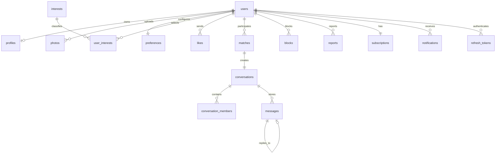

# Database

PostgreSQL 17 is the source of truth. SQL migrations live in `backend/migrations` and are applied alphabetically inside transactions. `schema_migrations` records successful files; an advisory lock prevents multiple backend replicas from racing.

## Core relationships



## Tables

- `users`: account identity, normalized unique email, optional phone extension point, password hash, verification/active state.
- `profiles`: 18+ birth date constraint, identity, city, bio, goal, private coordinates, online time, visibility, boost, onboarding state.
- `photos`: opaque UUID, owner, MinIO object key, unique ordered position 0-8.
- `interests`, `user_interests`: normalized many-to-many interest catalog.
- `preferences`: validated age, approximate distance, gender array, notification switch.
- `likes`: unique directed like or Super Like.
- `discover_actions`: auditable passes/likes and daily quota accounting.
- `matches`: canonical sorted user pair with reversible `unmatched_at` history.
- `conversations`, `conversation_members`: one conversation per match and membership/read cursor.
- `messages`: text/image, optional reply, persisted read and creation timestamps; media is referenced by object key.
- `blocks`, `reports`: safety records with cascading account cleanup.
- `subscriptions`: FREE/PREMIUM entitlement, expiry, provider, external billing reference.
- `notifications`, `notification_devices`: in-app events and provider-neutral device registration.
- `refresh_tokens`, `password_reset_tokens`: SHA-256 token digests, expiry, revocation/use timestamps. Raw tokens are never stored.

## Important indexes

- Partial discovery index on visible/onboarded profiles.
- Target/time index for received likes.
- Active-match indexes for each participant.
- Conversation/time index for message pagination.
- Partial unread-notification index.
- Partial active refresh/reset-token indexes.
- Daily/pass indexes for discovery quotas and seven-day pass suppression.
- Partial boost index for promoted discovery ordering.

## Privacy and retention

Latitude and longitude are deliberately absent from API responses. Distance is calculated server-side and rounded into approximately 5 km bands. Account deletion cascades relational data and explicitly removes profile/chat objects from storage. Reports are currently removed with the reporting or reported account; production moderation retention policy can move them into a separately governed audit store.

## Backup

For a development backup:

```powershell
docker compose exec -T postgres pg_dump -U velora -d velora -Fc > velora.dump
```

Production must use encrypted, access-controlled backups plus tested point-in-time recovery. MinIO/S3 versioning and lifecycle rules are separate from PostgreSQL backups.
